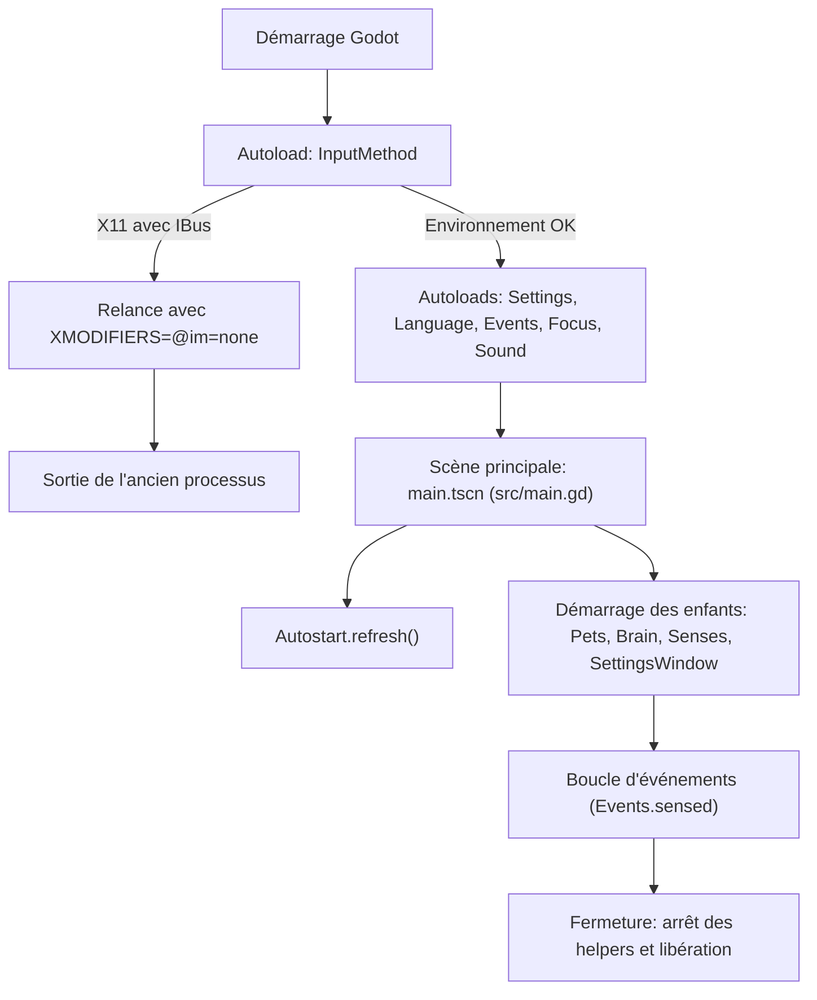

# Architecture et cycle de vie de Paros

Documentation technique du cœur du projet Paros ([`project.godot`](file:///home/user/Téléchargements/Paros_origin/project.godot)).

---

## 1. Vue d'ensemble et choix techniques

- **Type d'application** : Compagnon de bureau transparent multi-fenêtres pour Linux et Windows.
- **Moteur** : Godot 4.7, GDScript pur.
- **Rendu graphique** : `gl_compatibility` (OpenGL 3 ES). Pas de shaders lourds ni de composition 3D.
- **Consommation minimale** :
  - `run/low_processor_mode = true` : le moteur ne redessine que si un événement ou un changement intervient.
  - `run/max_fps = 30` : bridage dynamique à 30 FPS en mouvement, 12 FPS au repos, 2 FPS masqué.
- **Zéro asset externe** : Aucun fichier image (PNG/SVG) ni son (WAV/MP3). Graphismes vectoriels et sons synthétisés par code.

---

## 2. Configuration du moteur (`project.godot`)

Paramètres clés configurés dans [`project.godot`](file:///home/user/Téléchargements/Paros_origin/project.godot) :

- `window/subwindows/embed_subwindows = false` : Chaque nœud `Window` devient une vraie fenêtre de l'OS.
- `window/per_pixel_transparency/allowed = true` : Permet la transparence alpha du compositeur de fenêtres.
- `rendering/viewport/transparent_background = true` : Viewport initialisé transparent.
- `display_server/driver.linuxbsd = "x11"` : Compatibilité X11 / XWayland.
- `audio/driver/driver.linuxbsd = "Dummy"` : Désactive le thread audio par défaut sous Linux pour économiser les ressources.

---

## 3. Autoloads et Singletons

Déclarés dans [`project.godot`](file:///home/user/Téléchargements/Paros_origin/project.godot) et initialisés dans cet ordre strict :

```
1. InputMethod   (patch freeze X11)
2. Settings      (persistance INI/CFG)
3. Language      (dictionnaire i18n)
4. Events        (EventBus central)
5. Focus         (minuteur Pomodoro)
6. Sound         (synthèse procédurale audio)
```

### [`InputMethod`](file:///home/user/Téléchargements/Paros_origin/src/core/input_method.gd)
- **Rôle** : Contourner un bug critique sous X11 lié aux méthodes de saisie (IBus, Fcitx) lors de la destruction de fenêtres.
- **Fonctionnement** :
  - Si l'affichage tourne sous X11 sans `XMODIFIERS=@im=none`, `InputMethod` redémarre le processus avec cette variable et positionne `leaving = true`.
  - Stoppe immédiatement l'initialisation de la première instance avant affichage.

### [`Settings`](file:///home/user/Téléchargements/Paros_origin/src/core/settings.gd)
- **Rôle** : Chargement, validation et persistance de la configuration.
- **Emplacement** : `user://settings.cfg` (résolu vers `~/.local/share/paros/settings.cfg`).
- **Fonctionnement** :
  - Compare les clés existantes au dictionnaire `DEFAULTS`.
  - Complète automatiquement les clés manquantes.
  - Sauvegarde à chaque modification via `set_value()` et émet le signal `changed`.

### [`Language`](file:///home/user/Téléchargements/Paros_origin/src/core/language.gd)
- **Rôle** : Internationalisation dynamique (Anglais / Français).
- **Fonctionnement** :
  - Dictionnaire de traduction intégré dans le code source.
  - Enregistre une instance `Translation` pour la locale `"fr"` dans `TranslationServer`.
  - Bascule automatiquement selon `Settings` ou la locale du système.

### [`Events`](file:///home/user/Téléchargements/Paros_origin/src/core/events.gd)
- **Rôle** : Bus de messages applicatif (pattern Observateur / Pub-Sub).
- **Signal unique** : `signal sensed(event: StringName, data: Dictionary)`.
- **Méthode d'émission** : `Events.post(event, data)`.
- **Avantage** : Découple complètement les capteurs (`Senses`), l'interface (`UI`) et la logique de décision (`Brain`).

### [`Focus`](file:///home/user/Téléchargements/Paros_origin/src/core/focus.gd)
- **Rôle** : Minuteur de travail (cycle Pomodoro).
- **Phases** : `OFF`, `FOCUS`, `BREAK`.
- **Événements émis** : `focus_started`, `focus_finished`, `break_finished`.

### [`Sound`](file:///home/user/Téléchargements/Paros_origin/src/core/sound.gd)
- **Rôle** : Synthèse et émission de signaux sonores 8-bit.
- **Génération** : Calcul d'ondes carrées et de bruit blanc à 22 050 Hz (bips, carillons, toquements, acclamations).
- **Sortie Linux** : Génère un fichier WAV en mémoire et le joue via lecteur externe non bloquant (`pw-play`, `paplay` ou `aplay`).
- **Sortie Windows** : Utilise `AudioStreamGeneratorPlayback`.

---

## 4. Classes utilitaires statiques

### [`Desktop`](file:///home/user/Téléchargements/Paros_origin/src/core/desktop.gd)
- **Rôle** : Pont bas niveau avec le système d'exploitation.
- **Fonctionnalités** :
  - Gestion des chemins de runtime (`XDG_RUNTIME_DIR` ou répertoire temporaire).
  - Contrôle d'alimentation de l'écran via D-Bus GNOME Mutter.
  - Suivi des processus par PID (`/proc/<pid>` sous Linux, helper PowerShell sous Windows).
  - Activation de la fenêtre du terminal associé à une session (appel D-Bus `org.paros.Desktop.Activate`).
  - Envoi de signal sonore dans le terminal (`\a` dans `/proc/<pid>/fd/0`).

### [`Autostart`](file:///home/user/Téléchargements/Paros_origin/src/core/autostart.gd)
- **Rôle** : Enregistrement du démarrage automatique.
- **Linux** : Fichier `~/.config/autostart/paros.desktop` avec l'exécutable et `XMODIFIERS=@im=none`.
- **Windows** : Raccourci script dans le dossier de démarrage utilisateur (`Startup`).

---

## 5. Cycle de vie de l'application



1. **Initialisation** :
   - [`main.gd`](file:///home/user/Téléchargements/Paros_origin/src/main.gd) vérifie `InputMethod.leaving`.
   - Si valide, [`Autostart.refresh()`](file:///home/user/Téléchargements/Paros_origin/src/core/autostart.gd) met à jour le fichier lanceur avec le binaire courant.
2. **Construction de l'arbre** :
   - `Pets` ([`pets.gd`](file:///home/user/Téléchargements/Paros_origin/src/pet/pets.gd)) prépare le conteneur de fenêtres.
   - `Brain` ([`brain.gd`](file:///home/user/Téléchargements/Paros_origin/src/brain/brain.gd)) s'abonne à `Events.sensed`.
   - `Senses` démarre la détection en tâche de fond.
3. **Exécution** :
   - Capteurs et minuteurs émettent via `Events.post()`.
   - `Brain` traite les messages et orchestre les mascottes.
