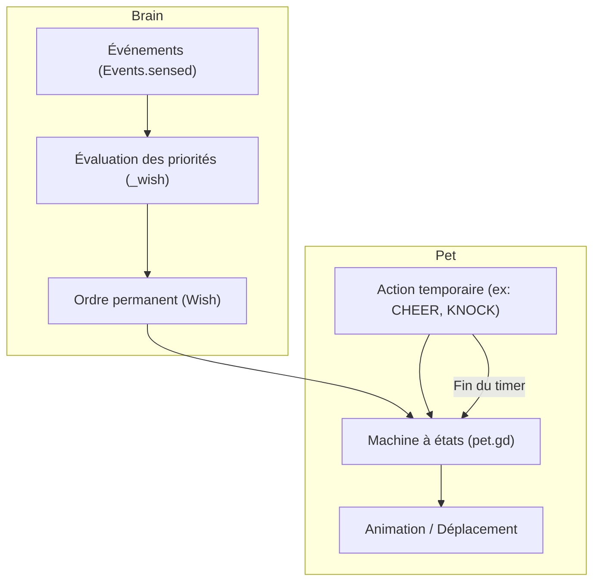

# Cerveau, machine à états et comportements

Documentation technique de la logique d'intelligence et des comportements autonomes dans Paros.

---

## 1. Rôle du Cerveau ([`brain.gd`](file:///home/user/Téléchargements/Paros_origin/src/brain/brain.gd))

Le nœud `Brain` centralise toutes les décisions de haut niveau. Il traduit les informations reçues de l'environnement (Claude Code, agy, Git, OS) en comportements visuels et sonores pour chaque mascotte.

- **Abonnement unique** : Se connecte à `Events.sensed`.
- **Registre interne** : Maintient le dictionnaire `_sessions` associant chaque identifiant de session à ses métadonnées (nom, phase, outil actif, tokens, branche, statut git).
- **Session par défaut** : Si aucune session Claude ou agy n'est détectée, affiche un personnage neutre sans nom (`NO_SESSION = ""`). Dès qu'une session apparaît, la mascotte par défaut disparaît.

---

## 2. Modèle décisionnel : Intentions (`Wish`) vs États locaux (`State`)

Paros distingue deux niveaux d'autonomie :

1. **L'intention (`Wish`)** : Dictée par le `Brain` au `Pet`. Représente l'état vers lequel la mascotte doit tendre en permanence.
2. **L'état local (`State`)** : Exécuté par le `Pet`. Comprend la physique, les animations et les actions minutées temporaires.

### Hiérarchie des priorités d'intentions (`_wish`)

Le Brain applique un ordre de priorité strict pour déterminer l'intention d'une mascotte :

1. `Wish.ALERT` : La session a besoin de l'utilisateur (`phase == "waiting"`, ex: question, confirmation d'outil).
2. `Wish.COMPACT` : Une compaction de mémoire/contexte est en cours d'exécution.
3. `Wish.THINK` : La session exécute un outil ou réfléchit (`phase == "working"`).
4. `Wish.WAIT` : Le tour est terminé mais un processus d'arrière-plan ou un sous-agent tourne encore (`_awaits`).
5. `Wish.SLEEP` : Mode nuit actif (`_night`), utilisateur absent (`_user_idle`) ou câlin contre la souris.
6. `Wish.ROAM` : Mode par défaut. La mascotte se promène librement, s'assoit ou regarde autour d'elle.

---

## 3. Boucles d'exécution du Cerveau

### Traitement réactif (`_on_sensed`)
Exécuté instantanément lors de la réception d'un événement sur le bus :

- `session_opened` / `session_closed` : Crée ou supprime l'instance de la mascotte correspondante.
- `session_finished` : Déclenche l'acclamation (`CHEER`) et un son de réussite. Si le tour provient d'une requête inter-session, le pet effectue un simple hochement de tête approbateur (`NOD`).
- `session_collision` : Si deux sessions éditent le même fichier, déclenche un regard noir (`GLARE`), un bruitage de colère et active un statut de rivalité de 10 minutes.
- `session_message_sent` / `session_mail` : Déclenche le lancer ou la réception d'une lettre volante physique.
- `pointer_tap` : Fait sauter de joie la mascotte cliquée.
- `pointer_double` : Demande au système de donner le focus au terminal lié et fait retentir sa cloche sonore.
- `repo_cleaned` : Déclenche l'animation de balayage du sol (`SWEEP`) puis équipe le pet de lunettes de soleil (`cool`) pendant 60 secondes.
- `screen_locked` : Masque les bulles textuelles et force le maintien de l'écran allumé sous GNOME.

### Boucle périodique (`_tick` à 1.0 s)
Surveille les conditions continues :

- **Surveillance des attentes** :
  - Si une session attend depuis plus de 20 s sans que son terminal n'ait le focus : envoie le pet toquer à la vitre de l'écran (`_send_to_knock`) toutes les 30 s.
  - Si l'attente dépasse le seuil `nag_minutes` : rappel verbal dans une bulle toutes les 60 s et statut urgent.
- **Tour de repos (`_grow_tower`)** :
  - Empile progressivement les mascottes inactives depuis plus de 90 secondes.
- **Actualisation (`_refresh`)** :
  - Met à jour le perchoir, l'allure de marche (basée sur le CPU), les accessoires, la fumée de contexte et les bulles descriptives.

---

## 4. Gestion des sous-agents ([`small_pets.gd`](file:///home/user/Téléchargements/Paros_origin/src/brain/small_pets.gd))

Chaque sous-agent spawned par Claude Code ou agy est représenté par une petite mascotte (échelle réduite).

### Cycle de vie
- **Naissance** : Apparaît aux pieds du pet parent avec une feuille de papier en main (`sheet = true`), s'éloigne au pas de course (`BIRTH_RUN`).
- **Périmètre** : Reste confiné dans un rayon dynamique autour de son parent (`home_x ± reach`).
- **Disparition** : Célèbre la fin de sa tâche (`CHEER`), court rejoindre les pieds de son parent et disparaît en moins de 6 s.
- **Plafond** : Limité par le réglage `subagents.max` (16 maximum).

### Comportements ludiques autonomes (`_play` à 0.25 s)
Les sous-agents libres interagissent entre eux :

- Sautiller sur place avec joie (`JUMP_CHANCE = 0.04`).
- Rendre visite à un sous-agent voisin et le saluer (`VISIT_CHANCE = 0.015`).
- **Pyramide humaine (`PYRAMID_CHANCE = 0.006`)** :
  - Calcule la taille maximale de triangle possible selon le nombre de petits disponibles.
  - Positionne les membres du rez-de-chaussée au sol.
  - Fait grimper successivement chaque membre sur les épaules des autres.
  - Le pet au sommet célèbre (`CHEER`).
  - La pyramide tient 8 secondes puis s'effondre.
  - Elle s'effondre immédiatement si un des membres est soulevé à la souris ou si un sous-agent termine son travail.

---

## 5. Actions contextuelles et détails d'immersion

Fonctionnalités avancées issues de l'observation des sessions réelles :

- **Le Sage (Advisor Claude)** :
  - Lors d'une consultation de l'Advisor, un grand personnage (stature 1.5) avec chapeau pointu, barbe blanche et bâton entre sur l'écran.
  - Le pet de la session lui lance une lettre. Le sage la lit au moins 5 s, renvoie sa réponse par lettre volante, puis quitte l'écran.
- **Compaction de mémoire** :
  - La mascotte installe une corbeille à papier métallique.
  - Elle extrait des feuilles de sa tête, les froisse et les jette dans la corbeille.
  - En fin de compaction, elle s'ébroue pour se secouer les idées.
- **Surchauffe de contexte (`fullness`)** :
  - Au-dessus de 75 % du quota de tokens, de la fumée commence à s'échapper de la tête de la mascotte.
- **Dossiers sales Git (`dirty`)** :
  - Porte une pile de dossiers cartonnés dont la hauteur augmente avec le volume de modifications (1, 50, 300 lignes). Chaque dossier alourdit la marche (`BAGGAGE_DRAG = 0.2`).
- **Conflits Git** :
  - En cours de rebase ou merge conflictuel, la mascotte porte un casque de chantier jaune et plante un panneau d'avertissement.
- **Retard par rapport à origin** :
  - Si la branche est en retard (`behind > 0`), le pet sort une carte routière et s'arrête en se grattant la tête.
- **Câlin du curseur** :
  - Si la souris reste immobile, le pet disponible le plus proche vient s'endormir blotti contre le curseur.
- **Toquement à l'écran (`knock_at`)** :
  - Si l'utilisateur tarde à répondre, la mascotte se rend sur le bord d'écran le plus proche du curseur et frappe contre la vitre de l'écran (secousses de fenêtre et toquements audio).
- **Surchauffe matérielle CPU** :
  - Si la température ou la charge processeur s'emballe, les mascottes allument un feu de camp et font griller une guimauve sur une branche (`ROAST`).
- **Écoute de la musique** :
  - Quand un lecteur audio tourne via MPRIS, les mascottes en repos ou en réflexion dodelinent de la tête en cadence.
